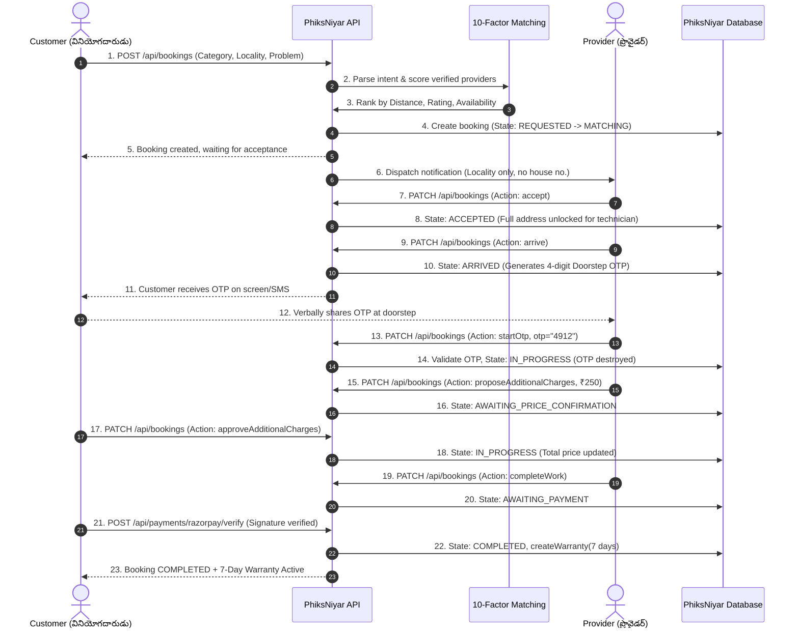

# PHIKSNIYAR — System Architecture Specification
**Version:** 1.0.0  
**Product:** PhiksNiyar (ఫిక్స్ నియర్)  
**Tagline:** Local help. Right when you need it. (లోకల్ సాయం. మీకు అవసరమైనప్పుడే.)  
**Initial Market:** Chilakaluripet, Palnadu District, Andhra Pradesh, India (PIN: 522616)

---

## 1. Executive Architecture Overview

PhiksNiyar is designed as a **server-authoritative, transaction-focused hyperlocal services platform**. Unlike legacy discovery directories that merely broker contact details, PhiksNiyar governs every stage of the service lifecycle—from AI-assisted intent interpretation to doorstep cryptographic verification, customer-approved extra charges, dual-verified cash settlements, automatic 7-day warranty registration, and administrative dispute resolution.

```
+---------------------------------------------------------------------------------------+
|                                    CLIENT LAYER                                       |
|  - Next.js 16 App Router (React 19)                                                  |
|  - Bilingual UI: English + Telugu (Noto Sans Telugu font stack)                      |
|  - Canonical PhiksNiyar Design System (#182B49 Deep Indigo, #0F9D72 Emerald, #F59E0B) |
|  - Role-aware Interfaces: Customer, Provider, Admin, Support                          |
+-------------------------------------------+-------------------------------------------+
                                            | HTTPS / Secure HTTP-Only Cookies
+-------------------------------------------v-------------------------------------------+
|                                 EDGE & ROUTING LAYER                                  |
|  - Next.js Edge Middleware                                                            |
|  - Security Headers (CSP, HSTS, X-Content-Type-Options, Frame-Ancestors)               |
|  - Sliding-Window In-Memory Rate Limiting (IP, Phone, User bounds)                   |
|  - Request Sanitization & Content-Length Enforcement                                 |
+-------------------------------------------+-------------------------------------------+
                                            |
+-------------------------------------------v-------------------------------------------+
|                                  APPLICATION SERVICES                                 |
|                                                                                       |
|  +--------------------+  +----------------------+  +-------------------------------+  |
|  | Auth & Session     |  | Booking Engine       |  | Provider Lifecycle            |  |
|  | - JWT (HS256)      |  | - 16-State Machine   |  | - 6-State Verification        |  |
|  | - Role Verification|  | - Doorstep OTP (4-D) |  | - Locality Geofencing         |  |
|  | - BOLA Enforcement |  | - Address Masking    |  | - Shift & Availability State  |  |
|  +--------------------+  +----------------------+  +-------------------------------+  |
|                                                                                       |
|  +--------------------+  +----------------------+  +-------------------------------+  |
|  | Financial Engine   |  | AI Matching Engine   |  | Post-Service Protection       |  |
|  | - Base & Parts Snap|  | - Telugu/English NLP |  | - 7-Day Free Rework Warranty  |  |
|  | - Razorpay HMAC    |  | - 10-Factor Ranking  |  | - 7-Category Dispute Claims   |  |
|  | - Cash Dual Confirm|  | - Zero DB Exposure   |  | - Immutable Audit Logging     |  |
|  +--------------------+  +----------------------+  +-------------------------------+  |
+-------------------------------------------+-------------------------------------------+
                                            |
+-------------------------------------------v-------------------------------------------+
|                                   DATA & STORAGE LAYER                                |
|                                                                                       |
|  [Primary Container/Edge]                     [Scalable Multi-Node Production]       |
|  SQLite 3 (WAL Mode, synchronous=NORMAL)     PostgreSQL 16+ (Supabase / Neon)        |
|  - Foreign Key Constraints                    - Row Level Security (RLS)              |
|  - In-Memory Indexing                         - ACID Transactions & Strict Constraints|
+---------------------------------------------------------------------------------------+
```

---

## 2. Core Architectural Pillars

### 2.1 Server Authoritative State
No business decision or state transition is accepted from the client without strict server-side verification:
- **Prices:** Fixed base rates and visiting charges are derived from backend catalog rules. Additional parts quotes require explicit customer approval before becoming payable.
- **Roles:** The client never specifies authorization roles. Roles (`CUSTOMER`, `PROVIDER`, `ADMIN`, `SUPPORT`) are baked into signed JWT tokens and re-verified against database records.
- **Doorstep Verification:** Technicians cannot enter `IN_PROGRESS` status without supplying the customer's cryptographically random 4-digit OTP.

### 2.2 Radical Privacy & Data Protection (DPDP Act 2023)
- **Address Privacy:** Street addresses are masked from providers during discovery and search. Providers only receive the coarse locality (e.g., "Kalamandir Center, Chilakaluripet") until they accept the booking.
- **Identity Protection:** Government identity documents (Aadhaar/PAN) are never stored in plaintext. They are processed via KYC verification providers, and records store only cryptographic salted hashes (`sha256(aadhaar + salt)`).
- **Transient Live Tracking:** Provider geolocation coordinates are only tracked and broadcast via Server-Sent Events (SSE) while the booking is actively in `ON_THE_WAY` or `ARRIVED`.

### 2.3 Bilingual First-Class Architecture
PhiksNiyar provides equal parity for Telugu (తెలుగు) and English:
- **Typography:** Rendered using Google Font `Noto Sans Telugu` with unicode normalization, ensuring zero broken glyphs or stacked consonants.
- **AI Matching:** The NLP intent parser extracts intent seamlessly from pure Telugu (`"మా AC cooling సరిగ్గా లేదు"`), Tanglish (`"Maa fridge cooling ledu bro"`), and English (`"My washing machine is leaking"`).

---

## 3. Component Architecture & Interactions

### 3.1 Customer Booking & Service Lifecycle


---

## 4. Multi-Database Architecture

PhiksNiyar implements a decoupled dual-database architecture:
1. **Containerized SQLite 3 (Default Local / Docker Single Node):**
   - Configured with `PRAGMA journal_mode=WAL` for high concurrency.
   - `PRAGMA synchronous=NORMAL` and `PRAGMA foreign_keys=ON`.
   - Data stored in durable `/app/data/phiksniyar.db` volume.
2. **PostgreSQL 16+ (Supabase / Managed Cloud):**
   - Full migration parity maintained in `schema.sql`.
   - Native `UUID` primary keys, `TIMESTAMPTZ`, and PostgreSQL `CHECK` constraints.
   - Robust Row Level Security (RLS) isolating tenant rows.

---

## 5. Security Boundary & IDOR/BOLA Protection

Every protected API route implements a three-tier authorization gate:
1. **Authentication Gate:** Validates the cryptographic signature of the HTTP-only JWT cookie.
2. **Role Gate:** Verifies the user possesses the requisite role (`CUSTOMER`, `PROVIDER`, `ADMIN`).
3. **Resource Ownership Gate:**
   ```typescript
   // Server-Side BOLA / IDOR Verification
   const booking = db.getBookingById(bookingId);
   const isCustomerOwner = booking.customerId === session.user.id;
   const isAssignedProvider = booking.providerId === session.user.id;
   const isAdminOrSupport = session.user.role === 'ADMIN' || session.user.role === 'SUPPORT';

   if (!isCustomerOwner && !isAssignedProvider && !isAdminOrSupport) {
     return NextResponse.json(
       { error: { code: 'FORBIDDEN', message: 'Unauthorized resource access' } },
       { status: 403 }
     );
   }
   ```

---

## 6. Resilience & Health Monitoring

The platform provides a zero-secret liveness and database probe at `/api/health`:
- Returns `status: "healthy"` when the database responds to `SELECT 1`.
- Exposes uptime, timestamp, active environment, and version.
- Excludes database connection strings, credentials, or filesystem paths.
