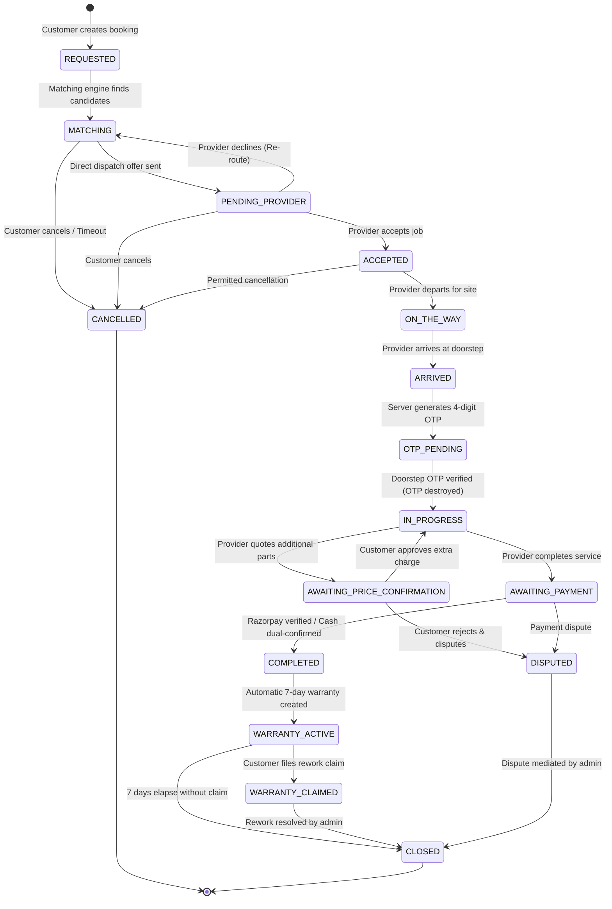

# PHIKSNIYAR — 16-State Booking Lifecycle & State Machine Specification
**Version:** 1.0.0  
**Initial Market:** Chilakaluripet, AP (PIN: 522616)

---

## 1. Overview

PhiksNiyar enforces a strict, server-authoritative 16-state transaction lifecycle. Unlike loose marketplace directories where jobs have arbitrary status toggles, every state transition in PhiksNiyar is validated on the backend against:
1. Current booking state
2. Authenticated user role and ownership
3. Business rules (e.g., Doorstep OTP verification, customer quote approval, payment verification).

---

## 2. State Machine Diagram

---

## 3. Transition Rules & Authorization Matrix

| Source State | Target State | Permitted Actor | Prerequisite & Invariant |
|---|---|---|---|
| `REQUESTED` | `MATCHING` | System / Admin | Booking created with valid category and locality. |
| `MATCHING` | `PENDING_PROVIDER`| System / Admin | Top-ranked verified provider selected. |
| `MATCHING` | `CANCELLED` | Customer / Admin | Customer requests cancellation prior to acceptance. |
| `PENDING_PROVIDER`| `ACCEPTED` | Assigned Provider | Provider must be `VERIFIED` and actively available. |
| `PENDING_PROVIDER`| `MATCHING` | Assigned Provider | Provider declines; returned to matching pool. |
| `ACCEPTED` | `ON_THE_WAY` | Assigned Provider | Address unlocked for navigation; live tracking starts. |
| `ACCEPTED` | `CANCELLED` | Customer / Admin | Allowed with potential cancellation policy check. |
| `ON_THE_WAY` | `ARRIVED` | Assigned Provider | Technician arrives at geofence radius. |
| `ARRIVED` | `OTP_PENDING` | System | 4-digit random OTP generated and dispatched to customer. |
| `OTP_PENDING` | `IN_PROGRESS` | Assigned Provider | Provider submits matching 4-digit OTP; OTP destroyed. |
| `IN_PROGRESS` | `AWAITING_PRICE_CONFIRMATION`| Assigned Provider | Additional charge amount > 0 and reason submitted. |
| `AWAITING_PRICE_CONFIRMATION`| `IN_PROGRESS`| Customer Only | Customer explicitly approves additional charges. |
| `IN_PROGRESS` | `AWAITING_PAYMENT` | Assigned Provider | Technician marks service work done. |
| `AWAITING_PAYMENT`| `COMPLETED` | Customer / Admin | Razorpay signature verified or Cash dual-confirmed. |
| `COMPLETED` | `WARRANTY_ACTIVE` | System | 7-day rework warranty record inserted automatically. |
| `WARRANTY_ACTIVE` | `WARRANTY_CLAIMED`| Customer Only | Claim filed within 7 days (`valid_until >= now`). |
| `WARRANTY_ACTIVE` | `CLOSED` | System | 7-day warranty expires without claim. |
| Any Active State | `DISPUTED` | Customer / Provider| Formal dispute filed under 1 of 7 categories. |
| `DISPUTED` | `CLOSED` | Admin Only | Admin enters resolution notes and remediation. |

---

## 4. Critical State Machine Rules

1. **Irreversibility:** Terminal states (`COMPLETED`, `CANCELLED`, `CLOSED`) can never transition backwards to `REQUESTED` or `IN_PROGRESS`.
2. **Doorstep Protection:** It is impossible to enter `IN_PROGRESS` without the server validating the 4-digit OTP. The OTP is rate-limited to 3 attempts, locking out brute-force attacks.
3. **No Unilateral Price Increases:** The provider cannot increase the booking amount without moving the state to `AWAITING_PRICE_CONFIRMATION`. The price only increments when the customer triggers `approveAdditionalCharges`.
4. **Idempotent Completion:** Multiple webhook retries or customer confirmation clicks will not double-credit earnings or register duplicate warranties.
